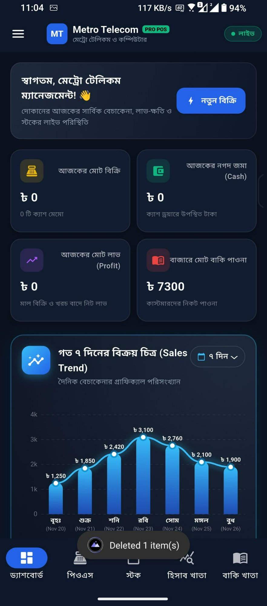
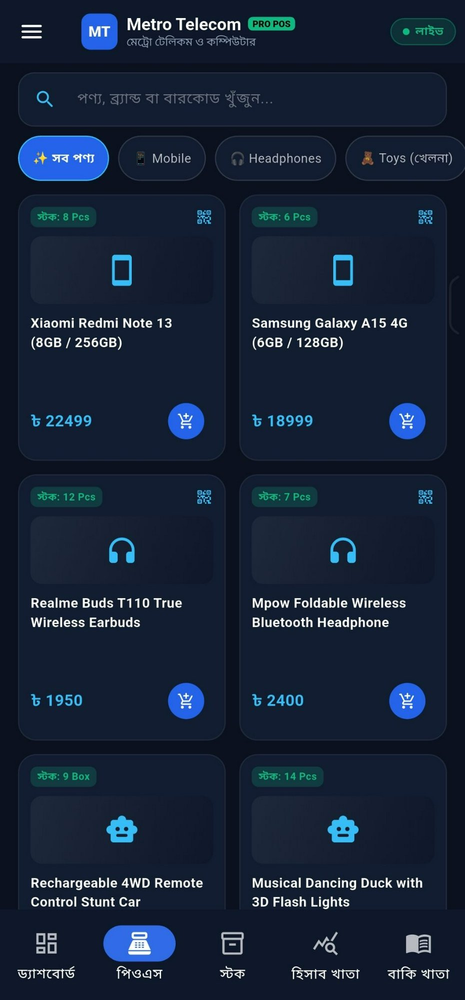
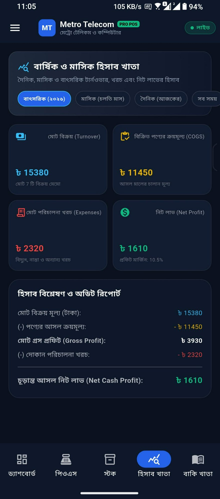
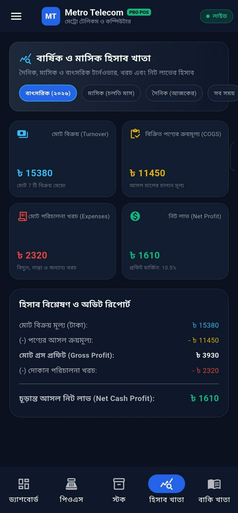
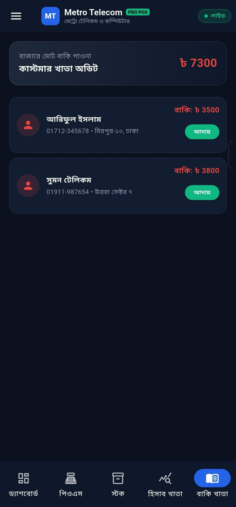
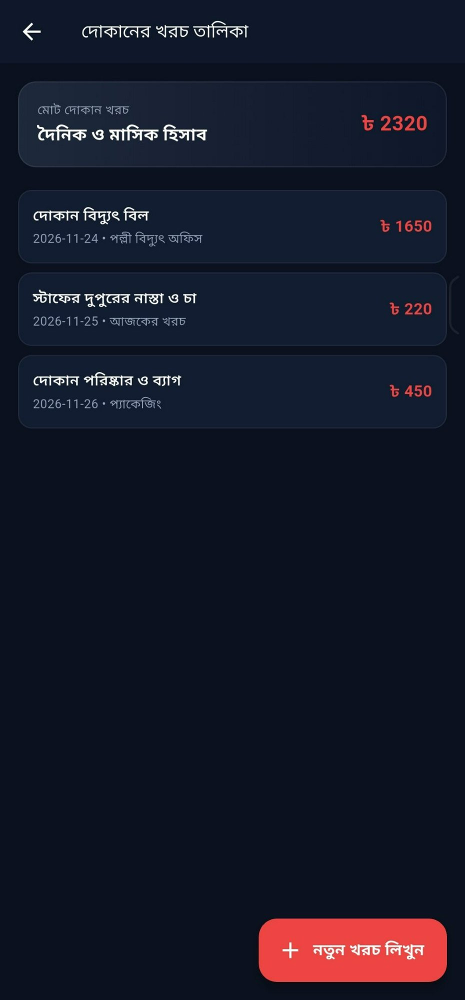
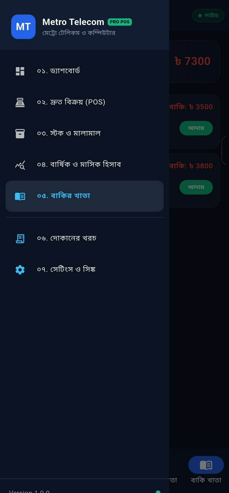
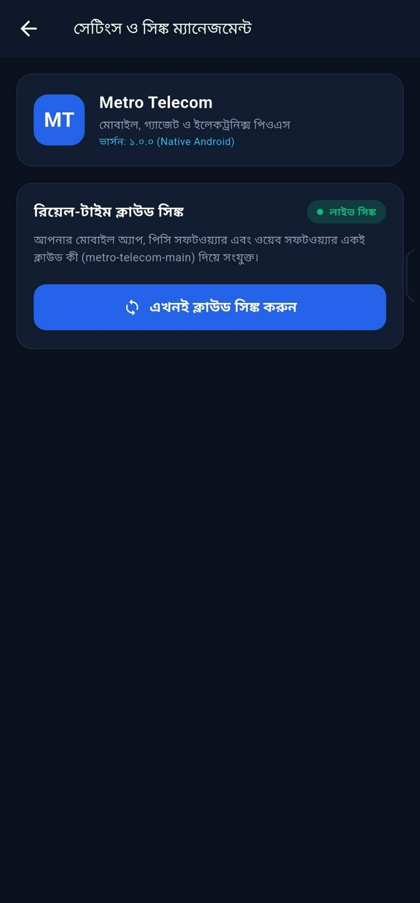

# 📱 Metro Telecom - Multi-Platform POS & Stock Inventory System

<div align="center">


### **মেট্রো টেলিকম ও কম্পিউটার** — আধুনিক পিওএস, ইনভেন্টরি ও বাকির খাতা সফটওয়্যার
> **"এক হোস্টিং, এক মাথা, পথ ৩টা"** — Web, Windows PC এবং Android Mobile একই ক্লাউড ডাটাবেজে রিয়েল-টাইমে সংযুক্ত!

[](https://github.com/shahin0964/Metro-Telecom/releases)
[](https://github.com/shahin0964/Metro-Telecom)
[](https://shahin0964.github.io/Metro-Telecom/)
[](LICENSE)

[🌐 সরাসরি লাইভ ব্যবহার করুন](https://shahin0964.github.io/Metro-Telecom/) • [💻 উইন্ডোজ সফটওয়্যার ডাউনলোড](https://github.com/shahin0964/Metro-Telecom/releases/latest) • [📱 অ্যান্ড্রয়েড অ্যাপ ডাউনলোড](https://github.com/shahin0964/Metro-Telecom/releases/latest)

</div>

---

## 📸 অ্যাপের স্ক্রিনশট গ্যালারি (App Screenshots)

<div align="center">

| 📊 ০১. ড্যাশবোর্ড ও সেলস ট্রেন্ড | 🛒 ০২. দ্রুত বিক্রয় (POS) ক্যাটালগ |
| :---: | :---: |
|  |  |
| *দৈনিক মোট বিক্রি, নগদ জমা, লাভ ও ৭ দিনের বিক্রয় চিত্র* | *মোবাইল ও গ্যাজেট ক্যাটালগ, ক্যাটাগরি ফিল্টার ও কার্ট* |

| 📦 ০৩. স্টক ও ইনভেন্টরি তালিকা | 📈 ০৪. লাভ-ক্ষতি ও অডিট রিপোর্ট |
| :---: | :---: |
|  |  |
| *পণ্য তালিকা, বর্তমান স্টক, ক্রয়/বিক্রয় মূল্য ও এডিট অপশন* | *টার্নওভার, বিক্রীত পণ্যের আসল ক্রয়মূল্য (COGS), খরচ ও নিট লাভ* |

| 📒 ০৫. কাস্টমার বাকির খাতা | 💸 ০৬. দোকানের খরচ তালিকা |
| :---: | :---: |
|  |  |
| *কাস্টমার অনুযায়ী বকেয়া ট্র্যাকিং ও সরাসরি বাকি আদায়* | *বিদ্যুৎ বিল, স্টাফ নাস্তা ও দোকানের দৈনন্দিন খরচের হিসাব* |

| 🧭 ০৭. সাইডবার ন্যাভিগেশন মেনু | 🔄 ০৮. রিয়েল-টাইম ক্লাউড সিঙ্ক |
| :---: | :---: |
|  |  |
| *সকল ফিচারে এক ক্লিকে যাওয়ার রেসপনসিভ ড্রয়ার* | *মোবাইল, পিসি ও ওয়েব সফটওয়্যার ক্লাউডে ইনস্ট্যান্ট সিঙ্ক* |

</div>

---

## 🚀 প্রধান সুবিধাসমূহ (Key Features)

- ⚡ **দ্রুত বিক্রয় ও কার্ট বিলিং (Fast POS)**: এক ক্লিকে পণ্য নির্বাচন, কুইক কোয়ান্টিটি পরিবর্তন, বিশেষ ছাড় (Discount) এবং ক্যাশ/বিকাশ/বাকি পেমেন্ট মোড।
- 📱 **ডুয়াল আইএমইআই (Dual IMEI) ট্র্যাকিং**: মোবাইল ফোন বিক্রয়ের সময় IMEI 1 ও IMEI 2 ইনপুট, বারকোড স্ক্যানার গান দিয়ে দ্রুত স্ক্যান এবং ক্যাশ মেমোতে প্রিন্ট সুবিধা।
- 🛡️ **ডিজিটাল ওয়ারেন্টি ভেরিফিকেশন**: IMEI বা মেমো নম্বর দিয়ে ক্রেতার ওয়ারেন্টির মেয়াদ এবং আসল ক্রয় রেকর্ড সেকেন্ডে যাচাই।
- 💰 **নিখুঁত লাভ/ক্ষতি (Accurate COGS Accounting)**: পণ্যের প্রকৃত ক্রয়মূল্য হিসাব করে মোট টার্নওভার, গ্রস প্রফিট, দোকান খরচ বাদ দিয়ে সঠিক নেট ক্যাশ প্রফিট গণনা।
- 💵 **ক্যাশ ড্রয়ারে বাকি আদায় ট্র্যাকিং**: কাস্টমার থেকে বকেয়া টাকা আদায় করলে তা স্বয়ংক্রিয়ভাবে আজকের ক্যাশ ড্রয়ারে (Cash in Hand) যুক্ত হয়।
- ↩️ **অর্ডার বাতিল ও স্বয়ংক্রিয় স্টক ফেরত**: কোনো বিক্রি ভুল হলে সাইডবারের "পেমেন্ট ও বিক্রয় হিস্ট্রি" থেকে এক ক্লিকে বাতিল করা যায়; সাথে সাথে মাল স্টকে ফেরত যায় এবং বাকির খাতা সমন্বয় হয়।
- 📦 **মডার্ন স্টক ইন (+ Restock) ও এডিট**: নতুন মাল দোকানে আসলে পপআপ থেকে এক ক্লিকে স্টক বাড়ানো, ক্রয়মূল্য/বিক্রয়মূল্য আপডেট এবং যেকোনো পণ্য তথ্য এডিট করার সুবিধা।
- ⏸️ **হোল্ড বিল (Hold Bill)**: ভিড়ের সময় বর্তমান ক্রেতার বিল হোল্ড করে নতুন ক্রেতার মেমো তৈরি করার ব্যবস্থা।
- 🖨️ **প্রফেশনাল ক্যাশ মেমো প্রিন্ট ও PDF**: ব্লুটুথ থার্মাল প্রিন্টার (58mm/80mm), সাধারণ A4 বা A5 লেজার/ইঙ্কজেট প্রিন্ট এবং সরাসরি PDF হিসেবে সংরক্ষণ।
- 🔄 **অফলাইন-ফার্স্ট ও রিয়েল-টাইম সিঙ্ক**: ইন্টারনেট না থাকলেও নিরবচ্ছিন্নভাবে চলবে এবং নেট পেলেই মোবাইল, কম্পিউটার ও ওয়েবে ডেটা স্বয়ংক্রিয়ভাবে সিঙ্ক হয়ে যাবে।

---

## 📥 ডাউনলোড ও ইন্সটলেশন (Downloads)

সর্বশেষ ভার্সন **[v1.0.5 Releases](https://github.com/shahin0964/Metro-Telecom/releases/latest)** থেকে ডাউনলোড করুন:

| প্ল্যাটফর্ম | ডাউনলোড ফাইল | বিবরণ |
| :--- | :--- | :--- |
| 🌐 **Live Web** | [https://shahin0964.github.io/Metro-Telecom/](https://shahin0964.github.io/Metro-Telecom/) | সরাসরি যেকোনো ব্রাউজারে রান করুন |
| 💻 **Windows PC (Installer)** | `Metro-Telecom-Setup-1.0.5.exe` | কম্পিউটারে ইনস্টল করার জন্য (ডেস্কটপ আইকন তৈরি হবে) |
| 💻 **Windows PC (Portable)** | `Metro-Telecom-Portable-1.0.5.exe` | কোনো ইনস্টলেশন ছাড়া পেনড্রাইভ বা পিসি থেকে সরাসরি রান |
| 📱 **Android Mobile** | `Metro-Telecom.apk` | যেকোনো অ্যান্ড্রয়েড ফোনে ইনস্টল করে ব্যবহার করুন |

---

## 🛠️ প্রযুক্তি কাঠামো (Tech Stack)

```
├── Web App / Desktop UI    : HTML5, CSS3 Modern Dark Theme, Vanilla JavaScript (ES6+)
├── Windows Desktop Engine  : Electron 30, Context Isolation, Native Win32 Print
├── Android Mobile App      : Flutter (Dart), Material 3, Bluetooth Thermal Printing
├── Multi-Platform CI/CD    : GitHub Actions Automated Build Pipeline
└── Cloud Data Engine       : Cloud Sync Engine & LocalStorage Offline Cache
```

---

## ⌨️ কিবোর্ড শর্টকাট (Keyboard Shortcuts)

- `Enter`: IMEI এন্ট্রিতে IMEI 1 থেকে IMEI 2 তে যাওয়া এবং সরাসরি কার্টে যোগ।
- `F11`: ফুল-স্ক্রিন মোড চালু / বন্ধ।
- `F5` / `Ctrl + R`: সফটওয়্যার রিলোড।
- `F12` / `Ctrl + Shift + I`: ডেভেলপার টুলস কনসোল।

---

## 📄 লাইসেন্স (License)

কপিরাইট © ২০২৬ **মেট্রো টেলিকম ও কম্পিউটার**। সর্বস্বত্ব সংরক্ষিত।
